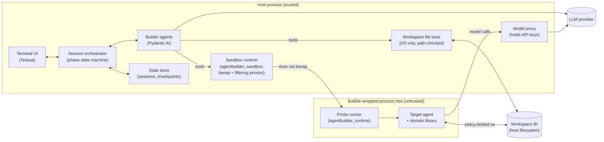
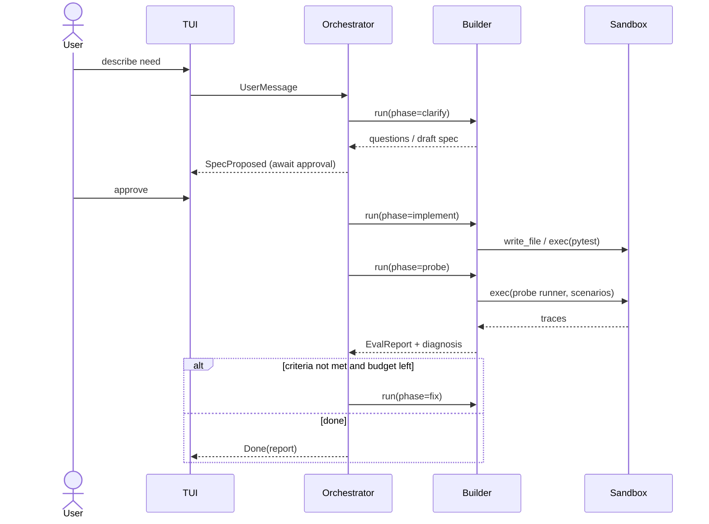

# 01 — Architecture

## Component view



### Responsibilities

| Component | Responsibility | Trust |
|-----------|----------------|-------|
| **Terminal UI** | Render chat, spec, files, runs; collect input and approvals. Knows nothing about agents beyond events. | Trusted |
| **Session orchestrator** | Owns the session state machine (phases, budgets, iteration count), routes user messages, emits UI events, enforces approval gates. | Trusted |
| **Builder agents** | Pydantic AI agents that reason and act through tools. They never touch the host filesystem directly — only via the sandbox client. | Trusted code, untrusted *output* |
| **Sandbox runtime** | Our own Python package (`agentbuilder_sandbox`), modelled on [sandbox-runtime](https://github.com/anthropics/sandbox-runtime): runs commands under bubblewrap + seccomp with no network namespace, filtering HTTP/SOCKS proxies on the host, resource limits and violation reporting. | Trusted |
| **Workspace file tools** | Host-side read/write/edit of the workspace directory for builder agents. Symlink-safe, never execute anything. | Trusted |
| **State store** | Persists sessions, specs, transcripts, checkpoints, eval reports on the host. | Trusted |
| **Agent registry** | One bare git repo per agent (versions = tags) plus an index (SQLite + FTS); list/search/version/import/export. See [08-agent-registry.md](08-agent-registry.md). | Trusted (repo contents untrusted) |
| **Run manager** | Spins up released agents in the sandbox for real tasks (one-shot, interactive, background, batch); keeps run records. | Trusted |
| **Model proxy** | Small reverse proxy that forwards target-agent model calls to providers, injecting real API keys and enforcing budget. Exposed to the sandbox as a bridged service (per-session Unix socket → loopback port inside). | Trusted |
| **Probe runner** | A tiny package installed into the target project's venv that imports the target agent, runs a scenario, and writes a JSON trace. | Runs sandboxed |
| **Target agent** | Generated code. Assumed hostile. | Untrusted |

## Key boundaries

1. **Host ↔ sandbox** is the security boundary. Generated code only ever runs as a
   bubble-wrapped process (kernel-enforced filesystem + network policy); the host only does
   file I/O on the workspace and never executes its content. See [04-sandbox.md](04-sandbox.md).
2. **Orchestrator ↔ builder** separates *deterministic control* (phases, budgets, approvals,
   checkpoints) from *LLM reasoning*. The LLM proposes; the orchestrator decides what is allowed.
3. **UI ↔ orchestrator** is an event stream, so the UI can be replaced (e.g. headless/CI mode)
   without touching the core.

## Main data flow



## Event model (orchestrator → UI)

All UI updates are typed Pydantic models on an async queue, e.g.:

`AssistantDelta`, `AssistantMessage`, `ToolCallStarted`, `ToolCallFinished`, `PhaseChanged`,
`SpecUpdated`, `FileChanged`, `ProbeStarted`, `ProbeFinished`, `EvalReportReady`,
`ApprovalRequested`, `BudgetUpdated`, `Error`.

User → orchestrator: `UserMessage`, `ApprovalResponse`, `Command` (slash commands), `Interrupt`.

## Proposed source layout

```
src/agentbuilder/
  __main__.py            # `agentbuilder` CLI entry (typer) -> launches TUI or headless
  config.py              # settings (pydantic-settings): models, budgets, sandbox backend
  orchestrator/
    session.py           # Session, phase state machine, budgets
    events.py            # UI <-> orchestrator event models
  builder/
    agents.py            # clarifier, architect, engineer, evaluator agents
    prompts/             # system prompts (markdown, versioned)
    tools/               # sandbox-backed tools exposed to builder agents
    deps.py              # BuilderDeps dataclass (sandbox, session, emit)
  spec/
    models.py            # AgentSpec, ToolSpec, Criteria, Scenario ...
  sandboxing.py          # session -> SandboxPolicy (profiles, protected paths, services)
  workspace/
    files.py             # symlink-safe host-side file tools
    git.py               # host-side checkpoints (hooks disabled)
  proxy/
    model_proxy.py       # LLM proxy for target agents (sandbox service)
  evals/
    runner.py            # drives probes, collects traces
    evaluators.py        # deterministic + LLM-judge evaluators
    report.py
  store/
    sessions.py          # persistence, checkpoints
  registry/
    manifest.py          # AgentManifest
    repos.py             # per-agent bare repos, tags, checkouts (safe git invocation)
    index.py             # index.sqlite, FTS search, reindex
    manage.py            # edit/clone/release/deprecate
    transfer.py          # export (git bundle / project / archive) and quarantined import
  runs/
    manager.py           # run sessions, run policy, secrets injection
    records.py           # run records, retention
  tui/
    app.py               # Textual app
    widgets/
packages/
  sandbox/agentbuilder_sandbox/  # standalone sandbox runtime (see 04-sandbox.md)
  runtime/agentbuilder_runtime/  # installed into target venvs: probe runner, trace schema
tests/
design/
```

## Technology choices (proposed)

| Concern | Choice | Notes |
|---------|--------|-------|
| Agent framework | Pydantic AI | Both builder and target agents. |
| Evals | `pydantic_evals` | Datasets, cases, evaluators, LLM judge. |
| Workflow | Plain async state machine (maybe `pydantic_graph`) | See [91-decisions.md](91-decisions.md). |
| TUI | Textual | Async, rich widgets, testable with `App.run_test`. |
| CLI | Typer | `agentbuilder`, `agentbuilder resume <id>`, `agentbuilder agents …`, `agentbuilder run …`. |
| Registry storage | git (CLI, invoked with hooks/filters disabled) | One bare repo per agent; versions are tags. |
| Registry index | SQLite (stdlib `sqlite3`) + FTS5 | Rebuildable from repos. |
| Secrets | `keyring` | OS keychain; never stored in agent repos or run records. |
| Config | pydantic-settings | env + `agentbuilder.toml`. |
| Sandbox | Own Python runtime modelled on sandbox-runtime: `bubblewrap` + seccomp (ctypes) + asyncio proxies; Linux/WSL2 first, Seatbelt on macOS later | No Node. System dependency: `bwrap`. See [04-sandbox.md](04-sandbox.md). |
| Repo layout | uv workspace | Root app + `packages/sandbox` + `packages/runtime`. |
| Packaging in sandbox | `uv` | Fast, reproducible envs for target agents. |
| Observability | Logfire / OpenTelemetry (optional) | Pydantic AI instruments natively. |
| Python | 3.14 (host) | Target projects pin their own uv-managed Python. |
