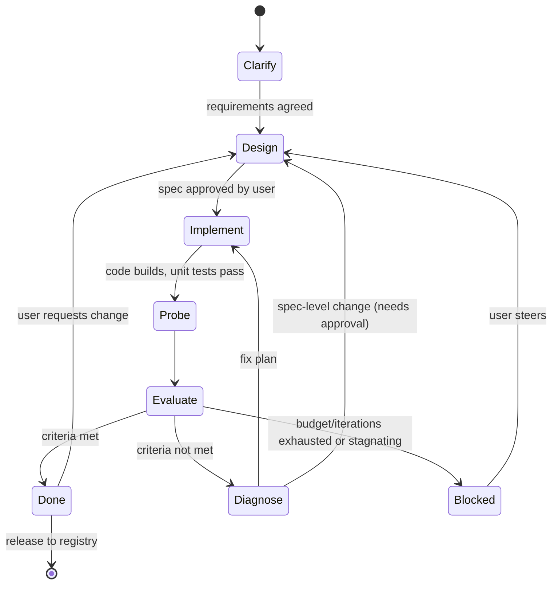

# 02 — Builder Agent

The builder is what the user talks to. It is not one monolithic prompt but a small set of
Pydantic AI agents, each specialised for one phase, coordinated by the deterministic
**session orchestrator**.

## Phases

| Phase | Goal | Output | Exit condition |
|-------|------|--------|----------------|
| **Clarify** | Understand the need, constraints, data sources, success criteria. | `Requirements` | User confirms summary. |
| **Design** | Produce the agent spec: role, system prompt, tools, deps, output type, domain library plan, scenarios & criteria. | `AgentSpec` vN | User approves (gate). |
| **Implement** | Write/modify code in the sandbox: domain library, tools, agent module, unit tests. | Files + passing `pytest`/`ruff`/type check | Static checks green. |
| **Probe** | Run the target agent on scenarios in the sandbox. | Traces | All scenarios executed. |
| **Evaluate** | Score traces against criteria. | `EvalReport` | — |
| **Diagnose** | Explain failures, classify root cause, plan a minimal fix. | `FixPlan` | Plan produced. |
| **Done / Blocked** | Report to user; await release or steering. | Summary | User action. |

A session can also start from an existing registry version (**edit**/**clone**): it begins in
Design with that version's spec, workspace and git history, and adds a regression gate — every
scenario that passed in the base version must still pass. See
[08-agent-registry.md](08-agent-registry.md#edit).

The user can talk at any time. A user message during an autonomous phase is delivered at the
next safe point (between tool calls) and may cause a phase change.

## Agents

Each phase agent is a `pydantic_ai.Agent` with its own instructions, tools and `output_type`.
They share one `BuilderDeps` (sandbox handle, session, event emitter, budget tracker).

| Agent | Output type | Tools (subset) |
|-------|-------------|----------------|
| **Clarifier** | `Requirements \| Question` | `ask_user` |
| **Architect** | `AgentSpec` | `ask_user`, `read_file`, `list_files`, `pip_search`* |
| **Engineer** | `ImplementationResult` | file tools, `run_command`, `add_dependency`, `run_unit_tests` |
| **Evaluator** | `EvalReport` (LLM-judge parts only; deterministic parts computed in code) | `read_trace` |
| **Diagnostician** | `FixPlan` | `read_trace`, `read_file`, `grep`, `run_probe` (single scenario) |
| **Front desk** | free text | `get_status`, `explain_spec`, `request_phase_change`, registry tools (`search_agents`, `describe_agent`, `run_agent`, `get_run`, `start_edit`) |

\* Optional, network-dependent.

The **front desk** agent handles chit-chat and questions ("why did scenario 4 fail?") without
disturbing the active phase. It is also the router for new requests: run an existing agent if
one fits, propose editing/cloning a close match, or start a new build. Whether front desk and phase agents should be merged is **OPEN**.

### Why multiple agents instead of one

- Smaller, focused prompts → better adherence and cheaper context.
- Each phase has a typed output the orchestrator can validate and gate on.
- Different phases may use different models (e.g. cheaper model for diagnosis triage, strongest
  model for architecture).

## Builder tools

File tools do host-side I/O on the workspace through `ctx.deps.workspace` (workspace-relative,
symlink-safe paths; nothing is ever executed on the host). Everything that *runs* code goes
through `ctx.deps.sandbox.exec`, i.e. as a bubble-wrapped process
(see [04-sandbox.md](04-sandbox.md)).

| Tool | Purpose |
|------|---------|
| `list_files(path, glob?)` | Directory listing. |
| `read_file(path, start?, end?)` | Read with line ranges. |
| `write_file(path, content)` | Create/overwrite. Emits `FileChanged`. |
| `edit_file(path, old, new)` | Exact-string replace; preferred for small fixes. |
| `grep(pattern, path?)` | Search workspace. |
| `run_command(cmd, timeout)` | Arbitrary shell in sandbox, bounded. Output truncated + saved as artifact. |
| `add_dependency(pkg)` | `uv add` in the target project; checked against an allow/deny policy. |
| `run_unit_tests(path?)` | `pytest` with JSON report → structured result. |
| `run_checks()` | `ruff`, type checker, import smoke test of the agent module. |
| `run_probe(scenario_id \| ad-hoc input)` | Run target agent once, return trace summary. |
| `run_eval(subset?)` | Run full/partial scenario set → `EvalReport`. |
| `read_trace(probe_id)` | Inspect a probe's full trace. |
| `update_spec(patch)` | Propose a spec change (requires approval if it changes criteria or tool surface). |
| `ask_user(question, options?)` | Block on user input via the TUI. |
| `checkpoint(message)` | Commit workspace state (git inside the workspace). |

Tool results are **summarised** for the model (bounded size) with a handle to the full artifact,
to keep context small during long loops.

## Prompting principles

- System prompts live in `builder/prompts/*.md`, versioned with the code, and are themselves
  covered by evals of the builder (meta-evals; see roadmap).
- The architect is instructed to prefer: **thin tools over a well-tested domain library**,
  explicit tool docstrings (Pydantic AI uses them as tool descriptions), typed tool arguments,
  structured `output_type` when the consumer is a program.
- The engineer must keep the [generated agent contract](03-generated-agent.md) and may not edit
  `evals/` acceptance criteria (only the user/architect via approved spec changes can) — this
  prevents "fixing" failures by weakening the tests.
- The diagnostician must classify each failure before proposing a fix:
  `prompt` · `tool-description` · `tool-bug` · `library-bug` · `missing-tool` · `spec-ambiguity`
  · `model-limitation` · `flaky`.

## Context management

Long build loops will exceed context windows. Strategies:

- Each phase agent starts from a **fresh, curated context**: spec + relevant files + latest
  report, not the whole chat history.
- The user-facing chat history is kept separately and summarised when handed to agents.
- Large outputs (logs, traces) are stored as artifacts and referenced by id.

## Budgets and guards (enforced by orchestrator, not the LLM)

- Max iterations per build (default 8), max wall time, max spend (builder + target separately).
- Stagnation detection: stop if pass-rate hasn't improved for N iterations, or the same
  failure signature repeats.
- Tool-call cap per phase run (Pydantic AI `UsageLimits`).
- Approval gates: spec changes affecting tools/criteria, adding network access, adding
  dependencies outside the allowlist.
