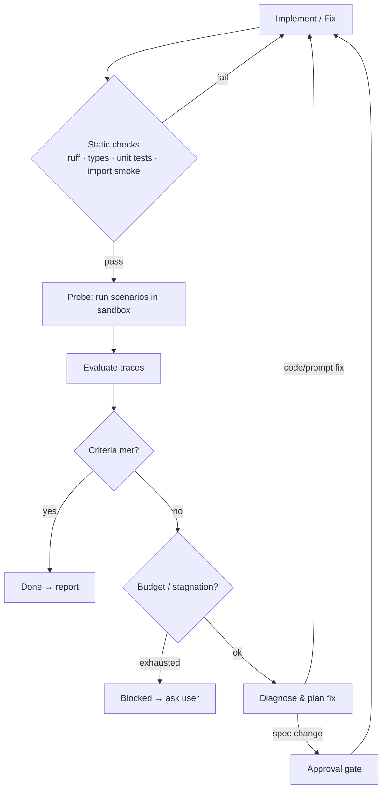

# 05 — Build–Probe–Fix Loop

The loop is the heart of AgentBuilder: turn "the code exists" into "the agent demonstrably does
what the user asked".



## 1. Static gate

Before any LLM-backed probing (which costs money and is noisy), cheap deterministic checks must
pass:

1. `uv sync` succeeds.
2. `ruff check` (errors only) and a type check (pyright/mypy — **OPEN**).
3. `pytest tests/unit` — domain library and tool tests.
4. Import smoke test: `python -m agentbuilder_runtime.smoke` imports `build_agent()`, verifies
   the contract, lists tools and their schemas (no model call; uses Pydantic AI `TestModel`).

Failures here go straight back to the engineer without consuming an iteration of the budget
(but they do count towards a separate "static fix" cap).

## 2. Probe

The **probe runner** (`agentbuilder_runtime`, installed into the target venv from a bundled
wheel) executes, as a bubble-wrapped process:

```
python -m agentbuilder_runtime.probe \
    --scenarios evals/scenarios.yaml [--ids a,b] [--repeat N] \
    --model <model> --out runs/<iteration>/
```

For each case it builds deps, runs the agent (`agent.run` / `agent.iter` to capture each
node), and writes a **trace**:

```json
{
  "probe_id": "it3-revenue_by_month-r1",
  "scenario_id": "revenue_by_month",
  "input": "...",
  "messages": [ /* Pydantic AI ModelMessage history (all_messages_json) */ ],
  "tool_calls": [{"name": "describe_table", "args": {...}, "ok": true, "duration_ms": 12}],
  "output": { /* Output model or text */ },
  "error": null,
  "usage": {"requests": 4, "input_tokens": 3120, "output_tokens": 410, "cost_usd": 0.012},
  "duration_s": 6.4
}
```

- Scenarios run concurrently with a cap; each run has a timeout and `UsageLimits`.
- `--repeat N` for non-determinism: a case's pass rate across repeats is reported, and cases
  that flip are flagged `flaky`.
- Ad-hoc probing: the builder (or the user via `/probe "..."`) can run a single input without
  a scenario, to explore behavior.

## 3. Evaluate

Built on `pydantic_evals` evaluators; two families:

**Deterministic** (computed in code, cheap, trusted):
- Output schema validity, field-level matches/regex/predicates.
- Tool-usage expectations: must-call, must-not-call, ordering, max calls.
- Hard requirements (e.g. `read_only` → SQL parser check).
- Cost/latency ceilings.
- No unhandled exceptions; retries within limit.

**LLM judge** (rubric-based, for qualities code can't check):
- Uses a *different* model/prompt than the target agent where possible.
- Returns `{pass: bool, score: 0..1, reason: str}` per rubric item.
- Judge prompts are fixed by the spec; the engineer cannot change them.

`EvalReport` aggregates: pass rate overall and by tag, hard-requirement violations, per-case
results with reasons, cost, latency percentiles, diff vs. previous iteration (fixed / regressed
/ still failing).

**Done** = `pass_rate ≥ min_pass_rate` AND zero hard-requirement violations AND no regressions on
cases that previously passed (configurable).

## 4. Diagnose

The diagnostician receives the report, failing traces (summarised), the spec and relevant files.
It must output a `FixPlan`:

```python
class FailureAnalysis(BaseModel):
    scenario_ids: list[str]
    category: Literal["prompt", "tool-description", "tool-bug", "library-bug",
                      "missing-tool", "spec-ambiguity", "model-limitation", "flaky"]
    evidence: str                 # quote from trace
    root_cause: str

class FixPlan(BaseModel):
    analyses: list[FailureAnalysis]
    changes: list[PlannedChange]  # file + intent, minimal
    requires_spec_change: bool
    new_regression_cases: list[Scenario]   # e.g. unit test for a library bug
    expected_effect: str
```

Guidelines encoded in its prompt:
- Prefer the **lowest layer fix**: a library bug gets a unit test + library fix, not a prompt
  workaround.
- One hypothesis per failure cluster; avoid shotgun edits.
- `spec-ambiguity` and `model-limitation` escalate to the user rather than being "fixed" in code.
- Never modify acceptance criteria, judge rubrics, or scenario expectations.

## 5. Fix

The engineer applies the `FixPlan`, re-runs the static gate, then the orchestrator re-probes:
first the **failing cases** (fast feedback), then the **full set** (regression check) only if the
targeted cases now pass.

## Loop control (orchestrator)

| Guard | Default |
|-------|---------|
| Max iterations | 8 |
| Max target-agent spend per build | configurable, e.g. $5 |
| Max builder spend per build | configurable, e.g. $10 |
| Stagnation | stop after 3 iterations without pass-rate improvement, or same failure signature twice |
| Wall-clock | 60 min |
| Checkpoint | after every iteration (git commit + report) |
| Rollback | if an iteration regresses, offer automatic revert to best checkpoint |

When stopping without success, the builder produces a **blocked report**: what passes, what
fails, best hypothesis, and concrete questions or options for the user.

## Anti-gaming measures

- Scenario expectations, judge rubrics and criteria are read-only to the engineer (enforced by
  the file tools, not just the prompt).
- A hidden **holdout** subset (architect-generated, never shown to diagnose/fix agents) is
  evaluated at Done to detect overfitting to visible cases.
- Hard-coding detection: deterministic check that scenario input strings don't appear verbatim
  in source files.
