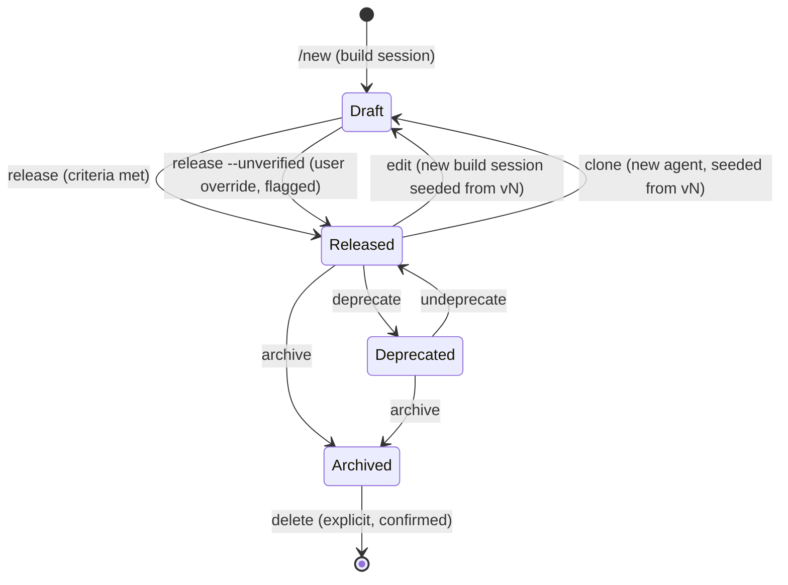

# 08 — Agent Registry: Bundling, Storing, Managing and Running Agents

Over time a user accumulates many agents. AgentBuilder therefore needs, beyond the build loop:

- a **storage model** — one git repository per agent, one immutable tag per released version;
- a **registry** — those repositories + an index to list, search and inspect agents;
- **management** operations — edit, clone, version, diff, archive, import/export;
- a **run mode** — spin up an agent in a sandbox to perform a real task, one-shot or
  interactive, in the foreground or background.

## Lifecycle



- An **agent** has a stable identity (`name` slug + ULID) and many **versions**.
- A **version** (`name@3`) is a git tag `v3` in the agent's repository, pinned to a commit
  SHA recorded in the index. It is immutable once released. Editing never mutates a version;
  it opens a build session that releases `name@4`.
- Each agent has a **current** version pointer (default: latest released). Runs use current
  unless a version is pinned. Rolling back = moving the pointer.
- A build session in progress is a **draft** of an agent and shows up in the list as such.

## Storage model: one git repository per agent

The build workspace is already a git repository (see
[07-state-and-persistence.md](07-state-and-persistence.md#checkpoints)), so the registry simply
keeps it: each agent is a **bare git repository**, and each released version is a **tag**.

Why git rather than archive files:
- Running, diffing, editing and inspecting need real files anyway — no unpack step, no
  double storage.
- Versions share unchanged content (git object store) instead of duplicating fixtures/code.
- History comes for free: edit/clone sessions start from the full build history.
- `git diff v2 v3` *is* the version diff; the commit SHA *is* the content hash.

Tree of a released commit:

```
manifest.json                 # AgentManifest (below)
README.md                     # generated usage docs
agent.spec.yaml               # the AgentSpec at release time
pyproject.toml
uv.lock                       # pinned deps -> reproducible env
.python-version
src/<agent_pkg>/...           # agent + tools
src/<domain_lib>/...          # optional domain library
tests/unit/...
evals/scenarios.yaml
evals/fixtures/...
reports/eval-report.json      # evaluation that justified this release
```

Never committed (`.gitignore` from the scaffold): `.venv`, `runs/`, caches. Session
transcripts stay in the session store.

Conventions:
- Branch `main` holds released history; each release is a commit "release vN" tagged
  `vN` (annotated tag carrying the manifest's quality summary).
- Checkpoint commits from build sessions are kept in history (useful for later diagnosis);
  drafts live on branches `draft/<session_id>` until released or discarded.
- Tags are never moved or deleted except by `agents delete`; the index stores each tag's
  commit SHA and verification fails if a tag no longer points at it.
- All git operations run on the host with hooks, fsmonitor, filters and submodules disabled
  (`-c core.hooksPath=/dev/null -c core.fsmonitor=false -c protocol.file.allow=never …`) —
  repository content is untrusted.

### Manifest

```python
class InputSpec(BaseModel):
    name: str                          # maps to a Deps field
    kind: Literal["text", "file", "dir", "json", "choice"]
    description: str
    required: bool = True
    default: Any | None = None

class SecretSpec(BaseModel):
    name: str                          # e.g. WEATHER_API_KEY
    description: str
    domains: list[str]                 # where it is allowed to be sent

class AgentManifest(BaseModel):
    format_version: Literal[1]
    name: str                          # slug, unique in registry
    version: int                       # monotonic per agent
    display_name: str
    description: str                   # one paragraph, used for search and routing
    tags: list[str]

    entrypoint: str                    # "schema_sql_agent.agent:build_agent"
    deps_factory: str                  # "schema_sql_agent.agent:build_deps"
    interface: Interface               # task prompt? inputs: list[InputSpec]; output kind + JSON schema;
                                       # conversational: bool
    model: ModelRequirements           # default model, known-good models
    python: str                        # "3.13"

    permissions: Permissions           # network allowlist, secrets: list[SecretSpec]
    quality: Quality                   # pass_rate, holdout_pass_rate, n_scenarios, unverified: bool,
                                       # avg_cost_usd, p50_latency_s, evaluated_at
    provenance: Provenance             # agentbuilder version, builder models, session id,
                                       # parent: "name@N" | None, created_at, author
```

(The manifest does not contain its own commit SHA; the index and the tag carry it.)

The manifest is generated from the spec + last eval report at release time; the user can edit
descriptive fields (display name, description, tags) but not quality/provenance.

`interface` is what makes generic running possible: the TUI renders a task form from `inputs`,
the CLI maps flags to them, and other agents can call the agent with typed arguments.

## Registry storage

```
~/.agentbuilder/registry/
  index.sqlite                        # metadata + FTS5 search index
  agents/<name>.git/                  # bare repo per agent; tags v1, v2, … = versions
  checkouts/<name>/<version>/         # read-only tree of a tag (cache, `git archive | tar -x`)
  envs/<name>/<version>/              # prepared venv (cache, rebuildable from uv.lock)
  runs/<run_id>/                      # run records (see below)
```

`checkouts/` and `envs/` are caches: deletable at any time and recreated on demand from the
repository.

`index.sqlite` tables:

| Table | Columns (key ones) |
|-------|--------------------|
| `agents` | id, name, display_name, description, tags, status, current_version, created_at, updated_at |
| `versions` | agent_id, version, tag, commit_sha, manifest_json, pass_rate, unverified, released_at, parent |
| `runs` | id, agent_id, version, mode, status, started_at, finished_at, cost_usd, task_summary, exit_reason |
| `drafts` | agent_id, session_id, based_on_version |
| `agents_fts` | FTS5 over name, display_name, description, tags, tool names, spec purpose |

The repositories are the source of truth; the index can be rebuilt from their tags and
`manifest.json` files (`agentbuilder registry reindex`).

## Management operations

| Operation | CLI | Behavior |
|-----------|-----|----------|
| List | `agents list [--tag t] [--status s]` | Table: name, current version, status, pass rate, last run, tags. |
| Search | `agents search "<query>"` | FTS5 ranking; optional semantic re-rank by an LLM over descriptions. |
| Show | `agents show <name>[@v]` | Manifest, interface, permissions, quality, versions, recent runs. |
| Versions | `agents versions <name>` | Version history with parents, pass rates, changelog from spec. |
| Diff | `agents diff <name>@a <name>@b` | `git diff va vb`, presented as spec diff + code diff + quality delta. |
| Edit | `agents edit <name>[@v]` | Opens a build session seeded from the version (see below). |
| Clone | `agents clone <name>[@v] <new-name>` | Like edit, but releases under a new agent identity (parent recorded). |
| Set current | `agents use <name>@v` | Move the current-version pointer (rollback/forward). |
| Tag / describe | `agents tag`, `agents describe` | Edit descriptive metadata of the agent (not of released content). |
| Deprecate / archive | `agents deprecate`, `agents archive` | Hidden from default list and routing; still runnable when pinned (deprecated) or not (archived). |
| Delete | `agents delete <name> [--version v]` | Confirmed; whole agent: removes repo, caches and index rows. Single version: deletes the tag (commits stay reachable only if later versions build on them). Run records kept unless `--purge-runs`. |
| Export | `agents export <name>[@v] <path>` | See *Export & import*. |
| Import | `agents import <path>` | See *Export & import*. |
| Re-evaluate | `agents eval <name>[@v] [--model m]` | Re-run the version's eval set (e.g. against a new model); results stored, version unchanged. |

### Edit

1. Create a build session; clone the agent's repository into a fresh workspace and create
   branch `draft/<session_id>` from tag `vN` (full history available to the builder).
2. The session starts in **Design** with the existing spec loaded and the request
   "what do you want to change?".
3. The normal build–probe–fix loop runs, with one extra gate: **all scenarios that passed in
   vN must still pass** (regression protection), plus any new scenarios for the change.
4. `release` produces `name@N+1` with `parent = name@N`, and (by default) moves `current`.

Multiple drafts per agent are allowed (e.g. two experiments from `@3`); releasing one does not
discard the other, but the second release must rebase onto the newer version or release as a
branch-off clone — **OPEN** (Q21).

### Release

`release` (from a build session, also offered automatically at **Done**):
1. Verify acceptance criteria are met at the best checkpoint — else require `--unverified`.
2. Run the holdout set once more on that checkpoint.
3. On the host (no code execution): at that checkpoint generate `manifest.json` and README,
   commit "release vN", tag `vN`, push the branch and tag into `agents/<name>.git`
   (fast-forward `main`), and update the index with the commit SHA.
4. Pre-build the run env (`uv sync --frozen` in the sandbox, install network profile) so the
   first run is fast.

## Running agents ("spin up")

Running is a separate mode from building: the agent's code is fixed, the goal is to do a real
task, and there is no builder in the loop.

```mermaid
sequenceDiagram
    actor U as User
    participant R as Run manager
    participant S as Sandbox (run policy)
    participant A as Agent (checkout of vN)

    U->>R: run invoice-recon@current {task, inputs}
    R->>R: resolve version, check env cache, check secrets & permissions
    R->>S: start(run policy)
    R->>S: copy inputs -> run/io/in
    S->>A: agentbuilder_runtime.run (one-shot or serve)
    A-->>S: output, files -> run/io/out
    S-->>R: result + trace + usage
    R-->>U: output, files, cost; run record saved
```

### Run sandbox policy

Derived from the manifest, stricter than build mode:

| Rule | Value |
|------|-------|
| Agent code (`checkouts/<name>/<v>`) | read-only |
| Env (`envs/<name>/<v>`) | read-only |
| Writable | `run/<id>/io/out`, `run/<id>/tmp` only |
| Readable inputs | `run/<id>/io/in` (copies of user files — never the originals' directories) |
| Network | model service + manifest `permissions.network` allowlist (approved at import/first run) |
| Secrets | only those declared in `permissions.secrets`, see below |
| Limits | per-run timeout, spend cap, memory/pids caps from config (overridable per run) |

### Secrets

Agents that call external APIs declare required secrets in the manifest. The user stores
values in the OS keyring via `agentbuilder secrets set <agent> <NAME>`; they are never written
into repositories, workspaces or run records.

At run time a declared secret is injected as an environment variable of the sandboxed process
for that run only. Because the agent code can read it, exfiltration is limited by the network
allowlist: a secret is only provided if every domain in its `SecretSpec.domains` is in the
approved allowlist, and the proxy logs every request to those domains. (Proxy-side injection
without exposing the value would require TLS interception — out of scope for v1.)

### Run modes

| Mode | Entry | Use |
|------|-------|-----|
| **One-shot** | `agentbuilder run <name> "task" --in file=x.pdf [--json]` | Single task → output (+ files). Scriptable. |
| **Interactive** | `agentbuilder chat <name>` / TUI | Conversation with the agent; runtime in `serve` mode keeps message history inside the sandbox process, JSON-lines over stdio. |
| **Background** | `--background` / TUI | Run detached; progress & result in the Runs panel; notify on completion. |
| **Batch** | `agentbuilder run <name> --batch tasks.jsonl` | Many tasks, concurrency cap, aggregate report. |

`agentbuilder_runtime` gains a `run` entry point next to `probe`: same contract
(`build_agent` / `build_deps`), maps `interface.inputs` to deps (file inputs → paths under
`io/in`), writes `result.json` + trace.

### Run records

```
runs/<run_id>/
  run.json          # agent@version, mode, inputs (redacted), status, timings, usage, cost
  trace.json        # same trace format as probes
  io/in/  io/out/   # input copies and produced files
  transcript.jsonl  # interactive mode
```

Runs are listed (`agentbuilder runs list [--agent a]`), re-runnable (`runs rerun <id>`, also
against another version for comparison), and retained per a configurable policy (age / count /
size).

### Feedback from runs to builds

A bad run is the best regression case. From a run record the user can:
- `runs flag <id> "expected X, got Y"` → stores feedback;
- `agents edit <name> --from-run <id>` → opens an edit session with that run converted into a
  new failing scenario (inputs copied into `evals/fixtures`, expectation from the feedback),
  so the fix is verified and protected from regressing.

## Using the registry from the chat

The front-desk agent (see [02-builder-agent.md](02-builder-agent.md)) gets registry tools:

| Tool | Purpose |
|------|---------|
| `search_agents(query)` | Find existing agents matching the user's need (FTS + description re-rank). |
| `describe_agent(name)` | Interface, permissions, quality. |
| `run_agent(name, task, inputs)` | Start a run — **always confirmed by the user** (shows agent, version, permissions, estimated cost). |
| `get_run(run_id)` | Status/result of a run. |
| `start_edit(name, request)` | Open an edit session. |

This gives the main chat a natural routing behavior: *"Do I already have an agent for this?
Yes → run it. Close → edit/clone it. No → build a new one."* The architect also searches the
registry during Design to reuse domain libraries or tool patterns from existing agents
(copying code into the new workspace, never importing across agents).

## Export & import

The registry's internal format is git; files only appear at the boundary.

**Export** — `agents export <name>[@v] <path> [--format …]`:

| Format | Produces | Use |
|--------|----------|-----|
| `bundle` (default) | `<name>.agentbundle` — a `git bundle` with the requested tags (all by default, or `@v` and its history) | Full-fidelity transfer to another AgentBuilder: versions, history, manifests. |
| `project` | A plain directory: the tree at `@v`, no history | Use the agent outside AgentBuilder as a standalone uv project (depends only on `pydantic-ai` + its own deps). |
| `archive` | `<name>-v<N>.tar.gz` of the tree at `@v` | Hand a single version to someone without git. |

`--no-history` (bundle format) squashes to the released commits only, dropping intermediate
checkpoints and discarded experiments.

**Import** — `agents import <path> [--as <new-name>]` accepts a `.agentbundle`, a project
directory, or an archive. Imported content is untrusted input:

1. Fetch into a quarantine bare repo with `transfer.fsckObjects=true`, hooks/filters/
   submodules disabled; reject trees with symlinks escaping the tree. Directories/archives
   are committed as a single "imported" release.
2. Validate every tagged `manifest.json` against the schema; reject unknown `format_version`.
3. Name clash: refuse, or `--as` a new name, or (same agent ULID) merge new tags if their
   history extends ours — existing tags are never overwritten.
4. Show the manifest summary — **permissions (network, secrets) and quality claims are
   presented as claims, not facts** — and ask for approval (or import with network disabled).
5. Move into `agents/<name>.git`, index it, prepare the env in the sandbox (install profile).
6. Re-run the evals locally (default on); record local quality next to the claimed quality.

Since build and run always happen in the sandbox, an imported agent has no more power than a
locally built one with the same approved permissions.

## Remote registries (later)

Since every agent is a git repository, a shared team registry can be an ordinary git host:
`agents push/pull <name> <remote>` with the same quarantine-and-verify steps as import, plus
signed tags. Out of scope for v1.
